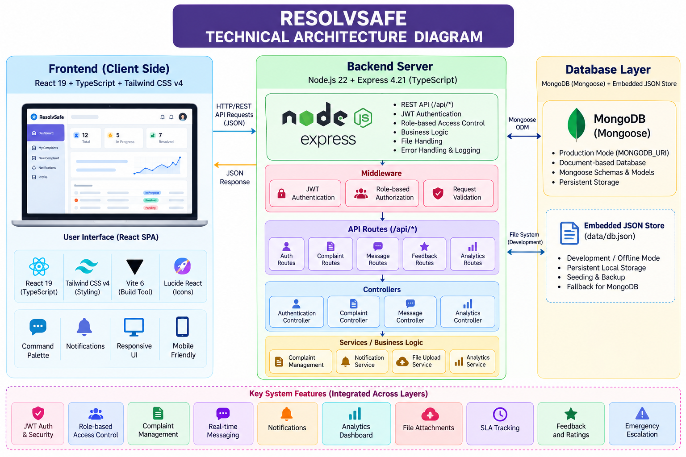

# ResolvSafe

**Complaint and Grievance Management System**

ResolvSafe is a web application for submitting, tracking, investigating, and resolving complaints. It provides role-aware workflows for users, resolution agents, and administrators, with complaint status tracking, messaging, feedback, notifications, and administrative analytics.

## Contents

- [Features](#features)
- [Technology Stack](#technology-stack)
- [System Architecture](#system-architecture)
- [Project Documentation](#project-documentation)
- [Project Structure](#project-structure)
- [Getting Started](#getting-started)
- [Environment Configuration](#environment-configuration)
- [Available Scripts](#available-scripts)
- [API Overview](#api-overview)
- [Security Notes](#security-notes)
- [Troubleshooting](#troubleshooting)

## Features

### User / Citizen
- Register and log in.
- Submit complaints with a category, department, priority, description, and supporting details.
- Track complaint status and view complaint details.
- Communicate through complaint-related messages.
- Receive notifications and submit feedback after resolution.

### Resolution Agent
- View and work on assigned complaints.
- Update complaint status and add notes.
- Communicate with users and review complaint details.

### Administrator
- Assign complaints to agents.
- Access administrative analytics and reports.
- Review system activity and support complaint escalation workflows.

### Application capabilities
- JWT-based authentication.
- Role-based authorization for protected operations.
- REST API built with Express.
- MongoDB persistence through Mongoose.
- Demo-data seeding during startup when the database is empty.
- Health-check endpoint for checking server and database status.

> The repository's current server code connects to MongoDB at startup and exits if the connection fails. Although an embedded JSON file exists in the repository, the current `server.ts` and database models use MongoDB; do not assume JSON storage is an active fallback unless that behavior is implemented separately.

## Technology Stack

| Layer | Technologies |
|---|---|
| Frontend | React 19, TypeScript, Tailwind CSS v4, Vite |
| Backend | Node.js, Express 4, TypeScript (`tsx`) |
| Database | MongoDB with Mongoose |
| Authentication | JSON Web Tokens (JWT), `bcryptjs` |
| Other libraries | `lucide-react`, `motion`, `dotenv` |

## System Architecture



At a high level, the React interface sends HTTP requests to the Express server. The server applies authentication and authorization where required, processes requests through API route handlers, and reads or updates MongoDB through Mongoose models. The server also serves the frontend through Vite middleware during development and serves the built frontend in production.

## Project Documentation

The following images are intended to live in `docs/images/`. Add each image to the repository using the matching filename for the links below to work.

### Architecture and Design

- [System Architecture](docs/images/system-architecture.png)
- [ER Diagram](docs/images/er-diagram.png)
- [MVC Pattern](docs/images/mvc-pattern.png)
- [Roles and Responsibilities](docs/images/roles-and-responsibilities.png)
- [User Flow](docs/images/user-flow.png)

### Codebase Structure

- [Frontend Folder Structure](docs/images/frontend-folder-structure.png)
- [Backend Folder Structure](docs/images/backend-folder-structure.png)

### Setup and Execution

- [Project Execution](docs/images/project-execution.png)

## Project Structure

```text
ResolvSafe/
├── data/
│   └── db.json                 # JSON data file present in the repository
├── server/
│   ├── models/                 # Mongoose models
│   ├── routes/                 # Express API route modules
│   ├── auth.ts                 # Authentication helpers
│   └── db.ts                   # Database exports and demo-data seeding
├── src/
│   ├── components/             # React UI components and dashboards
│   ├── context/                # Authentication context
│   ├── services/               # Frontend API client
│   ├── App.tsx                 # Main application component
│   ├── main.tsx                # Frontend entry point
│   └── types.ts                # Shared frontend types
├── .env.example                # Environment-variable template
├── package.json
├── server.ts                   # Express server and Vite integration
├── tsconfig.json
└── vite.config.ts
```

## Getting Started

### Prerequisites

- Node.js and npm.
- A running MongoDB instance, either local or hosted (for example, MongoDB Atlas).
- Git, if cloning the repository.

### 1. Clone the repository

Replace `<repository-url>` with the URL of your GitHub repository.

```bash
git clone <repository-url>
cd ResolvSafe
```

If the cloned folder has a different name, change into that folder instead.

### 2. Install dependencies

```bash
npm install
```

### 3. Configure environment variables

Create a `.env` file in the project root, using `.env.example` as a starting point. See [Environment Configuration](#environment-configuration) below.

### 4. Start MongoDB

Ensure MongoDB is running and that `MONGODB_URI` points to the correct database. The server attempts to connect to MongoDB when it starts.

### 5. Run the application

```bash
npm run dev
```

The `dev` script starts `server.ts`, which starts Express and uses Vite middleware for the frontend. By default, the application is available at:

- Application: `http://localhost:3000`
- Health check: `http://localhost:3000/api/health`

The server uses `PORT` if provided; otherwise, it defaults to port `3000`.

## Environment Configuration

Create a root-level `.env` file. Example:

```dotenv
PORT=3000
NODE_ENV=development
JWT_SECRET=replace_with_a_long_random_secret
MONGODB_URI=mongodb://127.0.0.1:27017/resolvsafe
GEMINI_API_KEY=your_gemini_api_key
APP_URL=http://localhost:3000
```

Notes:

- `MONGODB_URI` is optional in `.env.example`, but the server defaults to `mongodb://127.0.0.1:27017/resolvsafe` if it is omitted. MongoDB must still be available at the selected URI.
- Set `JWT_SECRET` to a strong, private value before deployment. Do not use a sample secret in production.
- `GEMINI_API_KEY` is listed in the provided environment template for Gemini API calls; configure it only if the corresponding functionality is used.
- `APP_URL` is included in the template for the hosted app URL.
- Never commit your real `.env` file, API keys, database credentials, or JWT secrets. The repository includes `.env.example` as a template.

## Available Scripts

| Command | Purpose |
|---|---|
| `npm run dev` | Starts the server and Vite development middleware. |
| `npm run build` | Builds the frontend and bundles the server into `dist/server.cjs`. |
| `npm start` | Starts the built server from `dist/server.cjs`. Run after a successful build. |
| `npm run lint` | Runs TypeScript type-checking with `tsc --noEmit`. |
| `npm run clean` | Removes generated build output using the configured shell command. |

Production build and start:

```bash
npm run build
npm start
```

## API Overview

All endpoints are served by the Express application. Protected routes require a valid JWT unless noted otherwise.

| Base path | Methods / examples | Purpose |
|---|---|---|
| `/api/health` | `GET` | Server health and database connection status. |
| `/api/auth` | `POST /register`, `POST /login`, `GET /me`, `GET /users`, `POST /switch-demo` | Registration, login, current-user lookup, user listing, and demo-role switching. |
| `/api/complaints` | `GET /`, `GET /:id`, `POST /`, `PATCH /:id/status`, `PATCH /:id/assign`, `POST /escalate` | Complaint listing, details, creation, status updates, assignment, and escalation. |
| `/api/messages` | `GET /:complaintId`, `POST /:complaintId` | Read and send complaint-related messages. |
| `/api/feedback` | `GET /`, `POST /` | Retrieve and submit feedback. |
| `/api/notifications` | `GET /`, `PATCH /:id/read`, `PATCH /read-all` | Retrieve and mark notifications as read. |
| `/api/analytics` | `GET /` | Administrative analytics; requires the admin role. |
| `/api/seed` | `POST` | Resets and re-seeds demo records; use carefully because it deletes existing seeded collections' records. |

For exact request bodies, validation rules, and response formats, refer to the route handlers under `server/routes/`.

## Security Notes

- Use a strong `JWT_SECRET` and keep all secrets out of source control.
- Use HTTPS and secure environment-variable management in deployed environments.
- Review the demo-role switching endpoint and demo credentials before exposing the app publicly.
- The `/api/seed` endpoint can reset application records; restrict or disable it in production if it is not needed.
- Do not use demo accounts or seeded sample data for real personal information.

## Troubleshooting

**The server exits during startup**

- Check that MongoDB is running.
- Verify `MONGODB_URI` and network access to the database.
- Check the terminal output for the connection error.

**The application does not open on port 3000**

- Check whether another process is using the port.
- Set a different `PORT` in `.env` and open the matching local URL.

**Authentication or API requests fail**

- Check the server terminal for errors.
- Confirm that login succeeds and the browser is storing the returned token.
- Verify that the request is reaching the expected local server.

## Contributing

1. Create a branch for your changes.
2. Keep changes focused and test the relevant workflows.
3. Update the documentation when routes, configuration, or features change.
4. Open a pull request with a clear summary of the changes.

## License

No license file was present in the supplied project archive. Add a `LICENSE` file if you intend to specify reuse or distribution terms.
